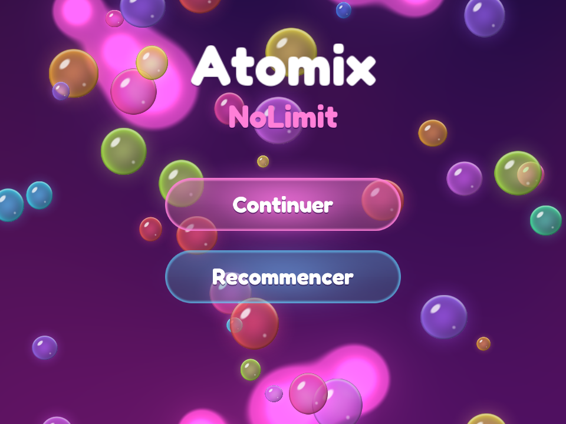
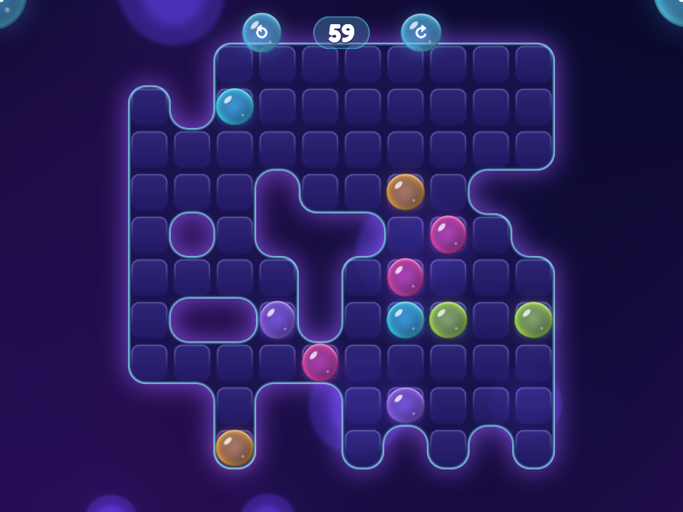
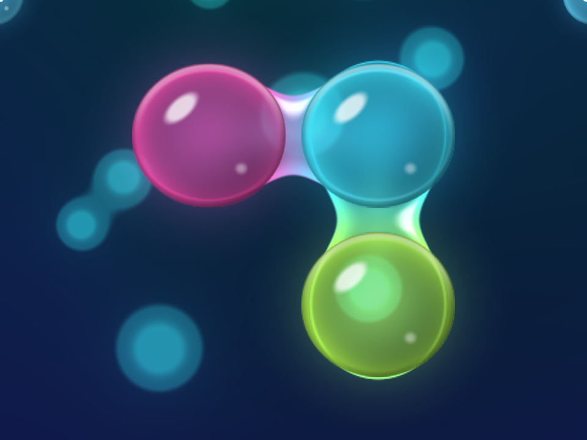
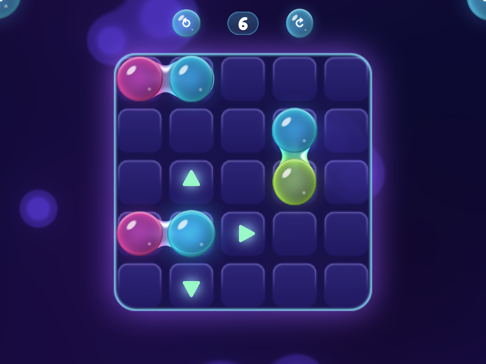

# Atomix NoLimit — version Haxe / Heaps

Portage du jeu Java (`../src`) sur [Heaps](https://heaps.io) : même génération de niveaux, mêmes
règles, mêmes trois vues (menu, plateau, molécule) et mêmes contrôles à la souris. Le jeu tourne
dans un navigateur (WebGL) et en natif avec HashLink.

   

## Design

Une lampe à lave éclairée comme une lampe à plasma. Tout est dessiné par le code au lancement,
il n'y a aucune image à part la police :

- **Fond** (`src/view/Plasma.hx`) : un shader HXSL avec un plasma de lumière lent et des gouttes
  lumineuses qui montent, fusionnent et redescendent ; une teinte par vue (menu rose et violet,
  plateau sombre, molécule bleu-vert).
- **Atomes** : des bulles translucides (corps teinté par la couleur de l'atome, reflets, halo)
  qui ondulent doucement ; l'atome sélectionné brille plus, un atome glisse avec une animation.
- **Filaments liquides** : deux atomes voisins placés comme deux atomes de la molécule (mêmes
  couleurs, côte à côte dans le même sens) sont reliés par un pont liquide, même si ce ne sont
  pas eux qui formeront la molécule au final (`Game.links`). Le pont se forme avec un léger
  rebond quand l'atome s'arrête, respire, et se rompt quand ils se séparent. La vue molécule
  relie ses atomes de la même façon.
- **Sol** (`src/view/FloorArt.hx`) : une seule texture où tous les angles sont arrondis, ceux du
  sol comme ceux des murs, avec une dalle vitrée par case, un liseré lumineux et un halo.
- **Interface** : boutons-bulles avec icônes, boutons du menu en verre, police arrondie Fredoka
  (SIL Open Font License, `res/font/OFL-Fredoka.txt`).

Les formes (bulles, pilules, icônes) sont calculées pixel par pixel à partir de la distance aux
formes (`src/view/Art.hx`), ce qui donne des bords lisses à toutes les tailles. Les assets de
[Kenney](https://kenney.nl) n'étaient pas accessibles depuis l'environnement de développement.

## Contrôles

| Où | Action |
|---|---|
| Plateau | clic gauche sur un atome : le sélectionne, des flèches montrent où il peut aller ; clic sur une flèche : l'atome glisse jusqu'au premier obstacle |
| Plateau | glisser avec le bouton droit : déplace le plateau ; molette : zoom ; clic droit : vue molécule |
| Plateau | boutons du haut : annuler le dernier coup, recommencer le niveau ; coins : menu (gauche), molécule (droite) |
| Molécule | glisser : déplace ; molette : zoom ; clic droit ou coin droit : retour au plateau |
| Menu | Continuer (retour à la vue précédente), Recommencer (la campagne repart du niveau 1), Quitter (HashLink seulement) |

## Construire et lancer

| Commande | Résultat |
|---|---|
| `haxe build-js.hxml` | `bin/game.js` : servir le dossier (`npx http-server -c-1 .`) et ouvrir `index.html` |
| `haxe build-hl.hxml` | `bin/game.hl` : `hl bin/game.hl` depuis ce dossier |
| `haxe test.hxml` | tests des règles (`test/TestModel.hx`), sans fenêtre : génère ~300 niveaux et vérifie que chacun se résout |
| `python3 tools/make_font.py` | régénère la police bitmap `res/font/round.*` depuis `tools/fonts/Fredoka.ttf` |

Ajouter `-debug` au build web expose le jeu à la page (`window.game`) pour les tests en
navigateur headless (skill `heaps-browser-test`).

Versions utilisées : Haxe 4.3.7, Heaps git `ec332019` (octobre 2026), format git ; pour
HashLink, HashLink git (SDL3) avec `haxelib dev hlsdl <hashlink>/libs/sdl` (voir le skill
`heaps-setup`).

## Organisation

| Fichier | Rôle | Équivalent Java |
|---|---|---|
| `src/model/Generator.hx` | génération d'un niveau : carte en blocs 5x5, molécule, puzzle par coups joués à l'envers | `AtomixGenerateur` |
| `src/model/Level.hx` | un niveau (sol, molécule, atomes de départ), difficulté par numéro, sérialisation | `AtomixNiveau` |
| `src/model/Game.hx` | la partie : glissement des atomes, annulation, détection de la molécule | `AtomixPartie` |
| `src/model/Campaign.hx` | la campagne sans fin : niveau suivant, reprise d'une sauvegarde | `AtomixCampagneNoLimit`, `AtomixJoueur` |
| `src/model/Rng.hx` | générateur aléatoire à graine (mêmes niveaux sur toutes les cibles) | `java.util.Random` |
| `src/Progress.hx` | sauvegarde (`hxd.Save` : `atomix.sav` ou `localStorage`) | `AtomixFile`, `AtomixSauvegarde` |
| `src/Main.hx` | l'application : les trois vues et le passage de l'une à l'autre | `AtomixControleur`, `AtomixVue` |
| `src/screen/` | `MenuScreen`, `GameScreen`, `MoleculeScreen` | `AtomixMenuVue`, `AtomixPartieVue` + `AtomixPartieControleur`, `AtomixMoleculeVue` |
| `src/view/Painter.hx` | dessin de chaque image : bulles, boutons, textes | `AtomixPainter` |
| `src/view/Art.hx`, `FloorArt.hx`, `Plasma.hx` | textures dessinées par le code, sol arrondi, fond animé | |
| `src/view/Palette.hx`, `Camera.hx`, `IconButton.hx` | couleurs, caméra, boutons ronds | `AtomixCamera`, les `mRectangle` |

Le modèle (`src/model/`) n'utilise pas Heaps : il est testé avec `--interp`.

## Différences avec la version Java

Le nouveau design (ci-dessus) remplace le dessin de la version Java ; avec lui, le menu a un
titre, un atome glisse au lieu de sauter, et la molécule terminée brille un instant avant le
niveau suivant (en Java le niveau suivant arrivait aussitôt).

Corrections et ajouts minimes faits pendant le portage :

- La partie en cours est sauvegardée à chaque coup (le niveau et ses coups) : on reprend où on en
  était. En Java la sauvegarde des coups était prévue mais vide (`SauvegardeUpdate`), seul le
  niveau était gardé.
- Le générateur ne plante plus quand la molécule est emmurée (la molécule est alors plus petite).
- Un clic juste à gauche ou au-dessus du plateau ne sélectionne plus la case 0 (division entière
  arrondie vers zéro en Java), et un clic sur un bouton ne sélectionne pas l'atome dessous.
- Le bouton « Quitter » n'existe pas dans la version web (une page ne peut pas se fermer).
